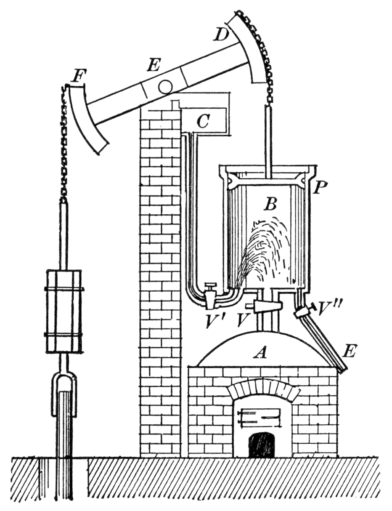
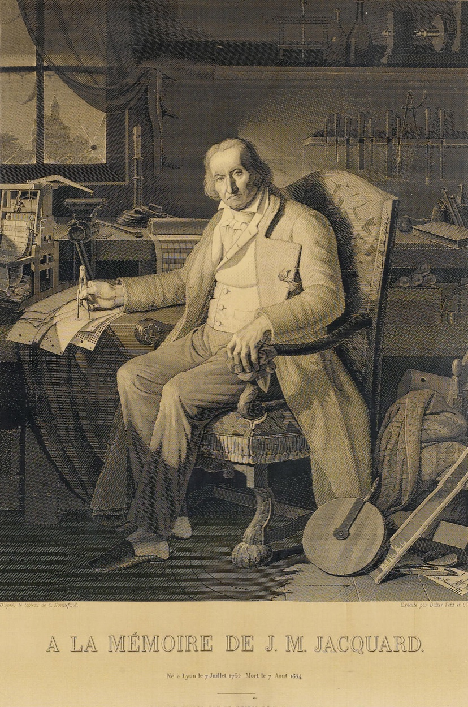

# The World That Builds Itself

*A Material History of Everything*

Heather Graham gave a team of researchers a meteorite sample and a sample of bay sediment and kept their origins to herself. Could the team tell which bore the marks of life? This book starts with the evidence a molecule can carry about its making. It asks what kind of evidence might let us recognize the making of a star, a society, a machine or even a law of physics.

How does change happen? At a flooded mine, water comes in at one rate and the pumps lift it out at another. An engine can change which rate wins. Coal from the newly accessible seam can pay to keep it running, provided someone can carry the coal to market. The book asks whether we can predict a next step like this from the parts on hand, the time it takes to put them together and what happens to their output. Its larger wager is that the routes that take hold sustain the greatest accessible rate of entropy production. Early life, two papers on relativity in June 1905 and the electricity bought to run AI put different parts of that argument to the test. The epilogue compares a Finnish data center with lunar ground, a microbe, an animal and the energy accounts of England and Wales in 1560 and 1950.

[Start with the prologue](manuscript/book/prologue.md) · [Chapter-by-chapter outline](editorial/outline.md)

  
  

Newcomen’s engine and Carquillat’s silk portrait of Jacquard appear in the chapters on the spread of machinery and on self-modeling. [Illustration credits](assets/images/README.md)

## Contents

[Prologue · The Sample Without a Name](manuscript/book/prologue.md)

### Part I · Physics

1. [What Moves at Absolute Zero?](manuscript/book/01-what-moves-at-absolute-zero.md)
2. [The Square with One Answer](manuscript/book/02-the-square-with-one-answer.md)
3. [Why the Beads Choose a Side](manuscript/book/03-why-the-beads-choose-a-side.md)
4. [What Lights a Star?](manuscript/book/04-what-lights-a-star.md)
5. [The White Towers of Lost City](manuscript/book/05-the-white-towers-of-lost-city.md)

### Part II · Humans

6. [Who Makes the Boundary?](manuscript/book/06-who-makes-the-boundary.md)
7. [The Observer Who Makes Mistakes](manuscript/book/07-the-observer-who-makes-mistakes.md)
8. [The People Who Divided the Ox](manuscript/book/08-the-people-who-divided-the-ox.md)

### Part III · Technology

9. [Who Owes Whom a Living?](manuscript/book/09-who-owes-whom-a-living.md)
10. [A Chariot and a Steam Engine](manuscript/book/10-a-chariot-and-a-steam-engine.md)
11. [What a Ship Could Say](manuscript/book/11-what-a-ship-could-say.md)

### Part IV · Paradox

12. [Could Physics Have Acquired Its Laws?](manuscript/book/12-could-physics-have-acquired-its-laws.md)
13. [How Soon Could Life Begin?](manuscript/book/13-how-soon-could-life-begin.md)
14. [Who Has Had Time to Get Here?](manuscript/book/14-who-has-had-time-to-get-here.md)
15. [Two Papers in June](manuscript/book/15-two-papers-in-june.md)

[Epilogue · What the Heat Meter Read](manuscript/book/epilogue.md)

## Sources and working material

Each chapter links to its sources. The research companion holds the natural experiments, historical comparisons, data and reproducible analyses, including the two-mines study. [Source ledger](research/sources.md) · [Research companion](research/evidence.md) · [Two mines](research/two-mines.md) · [Methods](research/causal-inference.md) · [Data and scripts](scripts/README.md)

The editorial files trace the development of the argument. The earlier eighteen-chapter plan preserves the factory, bakery, nitroplast, Osaka and Sam Eyde studies. [Expanded ideas](editorial/ideas.md) · [Original notes](editorial/notes.md) · [Manuscript guide](editorial/manuscript-guide.md) · [Earlier eighteen-chapter plan](editorial/archive/eighteen-chapter-outline.md) · [Earlier twelve-chapter book](editorial/manuscript-guide.md#the-twelve-chapter-draft)

## Quoting the book

You may quote excerpts with attribution. Retain the book title, chapter or section, source and any supplied author credits with the passage. [Quotation license](LICENSE) · [Illustration credits](assets/images/README.md)
