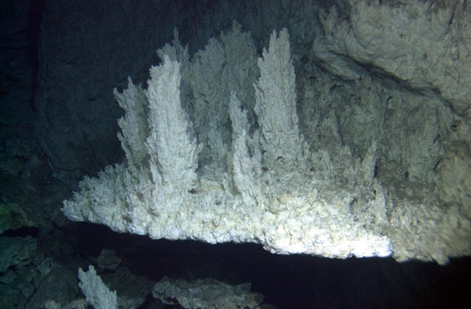

# Chapter 3 — Life Makes Its Conditions

In December 2000, Peter Rivizzigno was on watch in the control van aboard the research ship *Atlantis*. Far below, a camera sled called Argo II was photographing the flank of an undersea mountain. Across Rivizzigno’s screen came pale towers. He and another graduate student later pieced together overlapping photographs to see more of what the camera had passed. The tallest structures rose about fifty-five metres from the seafloor. The geologists Deborah Kelley and Jeff Karson went down in the submersible *Alvin* for a closer look.[1]

The place came to be called Lost City. Its stone had grown ledges, with delicate branching mineral deposits on top. Warm fluid collected beneath some of the ledges, where mats of microbes moved in the flow. Back on the ship, Kelley found tiny animals tucked into folds of the rock samples. Heather Hanna, a student who usually encountered fossils, found herself preserving animals as well as stone.[1]

*A carbonate ledge at Lost City, December 2000. The pale branches grow where vent fluid meets seawater.* [Plate credit](../assets/images/README.md#lost-city-vent)

Look at the ledge in the photograph. You could be looking at a thicket. The branching forms are mineral. Seawater circulating through mantle rock helps produce warm, alkaline fluids rich in hydrogen and methane. Where the rising fluid meets seawater, carbonate minerals precipitate. The walls grow around the passages through which the fluid comes. Microorganisms inhabit the warm pores inside those walls.[2]

Life at Lost City has quite a head start. The rock supplies much of the plumbing. It brings chemicals with different energetic possibilities within reach of each other and keeps fresh supplies coming. By the time a microbe takes its share, geology has already done work for it. Which part of making a living does the microbe still have to do for itself?

## Who repairs the wall?

Approach a cell from the outside. The first thing you meet is a boundary the cell helps to make. Through its membrane the cell exchanges material with its surroundings while keeping a distinctive chemistry going inside. Some of that chemistry supplies the parts of the membrane. Other reactions supply the machinery that controls what can cross it. Gradually the components you first encountered give way to replacements. The same cell can still be there.

There is a practical difficulty in such an arrangement. Suppose a molecule helps a reaction proceed fast enough to feed a second reaction, whose products help replace the first molecule. A chemist could draw a circle with arrows and give a correct account of these dependencies. Put the network in flowing water and the actual molecule might wash away long before its replacement arrives. For the circle to keep turning, production has to keep pace with loss. A pore that slows the loss can give the reactions time. If the reactions eventually help make a boundary of their own, they have gained some control over the very condition that once had to be supplied by the rock.[3]

That last step is a proposal about origins. In a living cell we can see the accomplished fact. A cell born today gets its start from an inheritance. To keep living it must renew enough of what it received. The name Francisco Varela, Humberto Maturana and Ricardo Uribe gave to this organization is *autopoiesis*, or self-production. Producing offspring is a further achievement. A cell that lives for a while without dividing still has plenty to do.[4]

Here the flooded mine offers a useful measure of how far we have traveled. At the mine, the fitter and the spare rod could arrive from another workshop. To see how the ability to pump was renewed, we had to follow the money and the work outside the shaft. A cell brings part of the workshop inside its own boundary. The reactions help make the wall that holds them together. Both still depend on a world beyond them.

The book proposes a direction to this history. An assembly can become more common when it opens a source of usable energy and puts some of the gain back into making itself. That qualification matters enormously to a cell. A faster reaction is worth very little if all its product washes out to sea. A cell with a slower pathway whose products keep the membrane in repair may leave many descendants. The larger conjecture is that, across a whole community, channels of this kind can drive the rate of entropy production toward the greatest value the surroundings allow. To recognize such a maximum we would have to know which other routes the same surroundings could support. The surviving cell gives us one route we can see.[5]

## How long did the first step take?

Eric Smith and Harold Morowitz ask what the appearance of life might look like from the rock’s side. Hydrogen-rich fluid carries chemical free energy. Some reactions that would release it proceed slowly. Suppose a series of reactions began to reinforce one another. The chemistry could then draw more readily on a supply that had been flowing past all along. In their account, metabolism begins as a way for geochemical energy to find a route through matter. A vent is especially interesting because the Earth keeps supplying both the difference and a place where the reactions can meet.[6]

Smith and Morowitz examined a particular cycle of carbon chemistry that still runs in some organisms. Could the properties of carbon and the energy available favor parts of that route even before an organism could maintain the whole? There is a foothold for such an idea. Reuben Hudson and colleagues showed that a difference in acidity across a mineral barrier could help drive the formation of formate, a small organic molecule, under vent-like conditions. The result takes the story as far as a particular piece of chemistry. A cell would also have to preserve the gain, replace what wore out and pass the capacity on. Whether living chemistry offers the most effective route for drawing energy from such a setting remains an open comparison.[6][7]

Consider how different this makes the question of luck. Imagine assigning an equal chance to every way of arranging the atoms of a cell, then waiting for our particular cell to turn up. That lottery has lost almost everything the sea actually had to work with. Stars had already made carbon and oxygen. Planetary history had brought water into contact with particular rocks. Every reaction inherited the products of earlier reactions. A molecule that leaves a pore in a second has different futures from one that sticks to its wall for an hour. A chain of reactions in which the third needs a product of the second simply cannot start at the third link.[8]

You can pick a mineral grain out of the water. Try picking out that last restriction. It has no separate piece of matter you can hold, yet the chemistry must obey it. That is the Platonic side of the book’s argument. The materials come with relations, often invisible to us, that narrow what can happen next. When enough of that hierarchy is in place, assembly can proceed at the pace of the accessible chemistry. Much of the waiting may have gone into making the circumstances. The Earth owes us no additional age in which to guess the finished cell.

Could life, then, have appeared as soon as Earth was ready? It is tempting to picture the oceans just past boiling, with life already at work in the cooling water. The oldest clues survive in quite different places. A zircon about 4.4 billion years old preserves evidence that material in its history interacted with liquid water. At the other end of the story, Australian rocks about 3.48 billion years old preserve traces of microbial communities in an ancient hot-spring setting. Between a grain that remembers water and a spring that already had inhabitants lies the event we would most like to see.[9]

Two later kinds of evidence narrow the question. In 2026, Oleg Abramov and colleagues modeled the early Earth as repeated impacts heated the crust and their effects gradually diminished. Their reconstruction identifies a favorable interval around **4.33 billion years ago** for RNA-related chemistry to persist. A separate study by Edmund Moody and colleagues worked backward from living organisms and placed their last universal common ancestor around **4.2 billion years ago**. The first date belongs to a model of conditions in which delicate molecules could last. The second belongs to a reconstruction of ancestry, already some distance into the history of life.[10]

The two dates fit a history in which the transition came early. Subtracting one from the other would give a beautifully precise answer to the wrong question. We have yet to find the first self-maintaining chemistry or establish where it arose. Lost City supplies something the dates cannot. There is a place you can visit where geology is still doing part of the work such a chemistry might have needed.

## Who would make the crossing?

How old is the oldest ocean that could have done what we are asking of Lost City? There is a version of the Fermi paradox hiding in that question. If life takes hold promptly when a planet is ready, the Milky Way seems to have given somebody an enormous head start. Why has nobody turned up here? The age of the Galaxy is a generous allowance. How much of it could anyone actually have used?[11]

My proposal is that life had to wait until relatively recent, chemically enriched planetary systems like our own. The Sun belongs to the broad group astronomers call *Population I*. Earlier stars helped make the elements that went into its planets. At Lost City we can see what became of some of that inheritance. Water reacting with fresh mantle rock feeds a flow rich in hydrogen. As that fluid meets seawater, a microbe can draw on a chemical difference that flowing water keeps replenishing. The wager is that only planets born late in this history inherited a mix of materials that could keep such gradients going long enough for living chemistry to take hold. On that account even the oldest biospheres would be comparatively recent in cosmic history. Earth already had microbial communities at least 3.48 billion years ago, so “recent” has to leave room for a very long history of life.[2][8][9][11]

Kepler-444 is a good reason to be exact about the wager. Five planets smaller than Earth orbit this metal-poor star. Its discoverers estimated its age at about eleven billion years. These five hug their star, but their very existence tells us the Galaxy could make small worlds remarkably early. The question for an ancient planet at a suitable distance is whether water could keep reaching fresh rock, how much chemical energy that contact supplied, and for how long. Find evidence that an indigenous biosphere was already thriving eight billion years ago, and the idea that life had to wait for the Sun’s generation fails.[12]

Now give one of those oceans inhabitants who can build a radio. They would like to know what is in the ocean under another sun. An automated probe can do the measuring and send the answer home. We have already made the smaller move ourselves. Both Voyagers crossed the outer boundary of the solar wind and sent back measurements from interstellar space. Sending a community asks something else of the ship. It must keep the passengers alive through the crossing and deliver enough of a working world for them to keep themselves alive afterward. While their own star supplies energy and their own ocean sustains them, what return could make that voyage worth more than the work they could do at home?[13]

A dying star changes the answer. As the home ocean becomes uninhabitable, the return on a passage can be a future for the voyagers’ children. Perhaps living worlds arose late enough that none with the means to leave has yet faced that choice. We know that some enriched stars have already finished their lives. The roughly eight-billion-year-old, metal-rich cluster NGC 6791 contains white dwarfs. The open question is whether a world around any such star had time for life, intelligence and the means of escape before its ocean was lost.[12][14]

The most serious objection comes from the people on the ship. A home port might see little return, while the voyagers’ descendants gain a world. Even an uncrewed probe able to build copies of itself could spread beyond the reach of its makers. A late start and a poor reward for departure could help explain a sky with few visitors. They also give us a reason to look separately for an inhabited ocean, a message and a machine. A society might have sent the last two while every one of its members stayed home.[13][14]

## What life leaves behind

Once a way of living exists, its frequency tells another story. Think of a sample containing thousands of copies of a complicated molecule. Something has made the same arrangement accessible over and over, or has preserved an old stock remarkably well. Which? Looking again at the count will hardly settle it. A room full of spare pump rods can stay full for years after the last fitter has retired. A working shop that dispatches every rod the day it is finished can look almost empty.

Assembly theory, developed by Abhishek Sharma and colleagues, puts two questions together. How many joining steps would it take to build an object under specified rules, if earlier pieces could be reused? How many instances of it are there? The combination can direct attention to a history of repeated production. The shortest route need not be the one history took, and conclusions about living origins depend on which operations were allowed. For the present argument, the telling discovery would be the working shop, the set of activities through which a product helps secure the next round of production.[15]

Seen on a large enough scale, the products can change the circumstances for everybody. Oxygen offers an extreme case. Microbes acquired the ability to use sunlight to draw electrons from water. In the course of making a living that way, they released oxygen. An oxygen molecule released into an ocean rich in substances with which it can react may scarcely travel before it is consumed. Quite a lot of life can therefore spend quite a long time producing oxygen with very little to show for it in the air.

Around 2.4 billion years ago that balance changed enough for oxygen to accumulate in the atmosphere. Geologists read part of this history in the changing proportions of sulfur isotopes preserved in rocks. The rise took time, and different waters had different histories. By doing the work of making a living, organisms had helped change the chemistry their descendants would have to live with. Oxygen offered some lineages a powerful new way of obtaining energy. It exposed others to a substance that could damage them.[16]

There is a reversal here worth keeping in mind. At Lost City the organism inherits much of its chemistry from its surroundings. On an oxygenated Earth, the surroundings themselves carry the consequences of earlier organisms. The boundary is real in both cases. What passes across it can eventually change the conditions on the other side. Biologists call this shaping of inherited environments *niche construction*. A planet full of organisms can make a world that is hard on many of them.[17]

## The past in the freezer

In 1988 Richard Lenski began following twelve populations of bacteria descended from the same ancestor. All received glucose in limited supply. Their surroundings also contained citrate, another possible source of carbon. In the presence of oxygen, the ancestral bacteria could make no such use of it. Generation after generation each population lived in a place that offered two resources while it drew on one.[18]

For more than 30,000 generations, this remained true of all twelve. Then one population changed. By about generation 31,500, some of its bacteria could use the citrate. The population expanded. The other eleven had been living beside the same opportunity.

This is an awkward outcome for anyone, myself included, who thinks an assembly can arise promptly when the conditions are ready. We could look at the one population and declare that it must have been ready, then account for the other eleven by pointing to their failure. That would tell us exactly as much as counting to twelve. What we would like is some access to the winning population while it is still losing.

Lenski’s team had kept samples frozen at intervals. Zachary Blount, Christina Borland and Lenski could go back to earlier generations and see whether descendants of those bacteria would acquire the capacity. Descendants from some later samples were more likely to do so than those from early in the lineage’s history. Even the winning line had changed its chances before it changed its diet. Later work found a further distinction. The first capacity to use citrate was weak. Making good use of the resource took more evolution.[18][19]

Think of the first pump that could just keep a passage clear. Someone looking down a dry shaft a generation later might find it hard to believe how marginal the first success had been. Here, too, what the mature arrangement can do offers a poor guide to what it cost to get there. The citrate really had been present all that time. An earlier history within one lineage had changed which step was within reach. Even then, eleven other populations went on living their lives another way.

The surprise in the next chapter runs in the opposite direction. In June 1905 a note by Henri Poincaré on the dynamics of the electron went before the French Academy. Later that month Albert Einstein submitted his paper on the electrodynamics of moving bodies. Working along different routes, they had approached some of the same relations between light and motion.[20] If the space of possible ideas is as large as it looks, why should two people arrive so close together? On the Atlantic seafloor the camera could show the tower long before anyone understood what the rock had done to make it possible. We have the two papers. What was already in place by the time their authors sat down to write?

## Chapter notes

1. The December 2000 report identifies Peter Rivizzigno’s watch, the tower heights, the *Alvin* dive, the microbial mats and Heather Hanna’s work with samples. [Duke expedition account](https://today.duke.edu/2000/12/alvind15.html)
2. Deborah S. Kelley and colleagues describe reactions between seawater and mantle rock, the carbonate structures and microbial communities. [“A Serpentinite-Hosted Ecosystem”](https://doi.org/10.1126/science.1102556)
3. Formal accounts of chemical networks distinguish reactions that can supply one another from rates sufficient to maintain the components. [Hordijk and Steel on autocatalytic sets](https://doi.org/10.1016/j.jtbi.2003.11.020) · [Dittrich and Speroni di Fenizio on chemical organization](https://arxiv.org/abs/q-bio/0501016)
4. Francisco Varela, Humberto Maturana and Ricardo Uribe introduced a model of the self-producing organization of living systems in 1974. [Original article](https://reflexus.org/wp-content/uploads/Varela_Maturana_Uribe_1974_Autopoiesis.pdf)
5. Thermodynamic limits depend on the specified process and conditions. [England on replication and dissipation](https://arxiv.org/abs/1209.1179) · [Kolchinsky on interpreting bounds on replication](https://arxiv.org/abs/2404.01130) · [Martyushev and Seleznev on maximum entropy production](https://arxiv.org/abs/1311.2068)
6. Eric Smith and Harold Morowitz develop the account of energetic channels and examine constraints on the reverse citric-acid cycle. [Energy flow and living organization](https://doi.org/10.1002/cplx.20191) · [Universality in intermediary metabolism](https://doi.org/10.1073/pnas.0404922101) · [*The Origin and Nature of Life on Earth*](https://doi.org/10.1017/CBO9781316348772)
7. Reuben Hudson and colleagues report abiotic formation of formate driven by a pH gradient. [Primary paper](https://doi.org/10.1073/pnas.2002659117)
8. Burbidge and colleagues develop the stellar history of the elements. The pore and reaction sequence in the text illustrate how physical residence times and chemical dependencies restrict possible histories. [“Synthesis of the Elements in Stars”](https://doi.org/10.1103/RevModPhys.29.547)
9. [Wilde and colleagues on early liquid water](https://pubmed.ncbi.nlm.nih.gov/11196637/) · [Djokic and colleagues on the Dresser Formation](https://www.nature.com/articles/ncomms15263). An older zircon contains carbon whose possible biological origin is debated. [Bell and colleagues](https://doi.org/10.1073/pnas.1517557112)
10. [Abramov and colleagues on the Hadean thermal window](https://www.nature.com/articles/s41467-026-76978-3) · [Moody and colleagues on the age of the last universal common ancestor](https://doi.org/10.1038/s41559-024-02461-1). Inferences from the early appearance of life also depend on the time needed for an observer to arise. [Kipping on observer selection](https://arxiv.org/abs/2005.09008)
11. Population I includes stars with a range of ages. Lineweaver, Fenner and Gibson modeled where and when the Galaxy could support inhabited planets under specified assumptions about enrichment and other conditions. Their model allows many candidates older than Earth. [Stellar populations](https://www.astronomy.ohio-state.edu/thompson.1847/1144/Lecture24.html) · [Galactic habitability model](https://doi.org/10.1126/science.1092322). The proposed late opening for life-sustaining gradients is this book’s conjecture.
12. Campante and colleagues measured the sizes of the five planets and dated their host Kepler-444. García-Berro and colleagues studied white dwarfs in the old, metal-rich cluster NGC 6791. [Kepler-444](https://arxiv.org/abs/1501.06227) · [NGC 6791](https://www.nature.com/articles/nature09045)
13. NASA describes the Voyager crossings of the heliopause and the measurements returned to Earth. [Voyager Interstellar Mission](https://science.nasa.gov/mission/voyager/interstellar-mission/). The comparison with sending and sustaining an interstellar settlement is the author's argument.
14. Hansen and Zuckerman model migration as a response to stellar evolution, including how a close stellar passage could shorten the journey. Carroll-Nellenback and colleagues model conditions under which settlements spread or leave regions unoccupied. Tipler considered the challenge posed by self-reproducing probes. [Stellar evolution and migration](https://arxiv.org/abs/2102.05703) · [Galactic settlement](https://arxiv.org/abs/1902.04450) · [Self-reproducing probes](https://adsabs.harvard.edu/pdf/1980QJRAS..21..267T)
15. [Sharma and colleagues on assembly and abundance](https://www.nature.com/articles/s41586-023-06600-9) · [Uthamacumaran and colleagues on limitations of molecular assembly measures](https://www.nature.com/articles/s41540-024-00403-y)
16. [Farquhar, Bao and Thiemens on atmospheric sulfur isotopes](https://pubmed.ncbi.nlm.nih.gov/10926533/) · [Gumsley and colleagues on the timing of oxygenation](https://doi.org/10.1073/pnas.1608824114)
17. Laland, Odling-Smee and Feldman examine how organisms change selection pressures for later generations. [Niche construction and evolution](https://doi.org/10.1017/S0140525X00002417)
18. Zachary Blount, Christina Borland and Richard Lenski trace the history of citrate use in one of twelve populations of *E. coli*. [Original study](https://doi.org/10.1073/pnas.0803151105)
19. Quandt and colleagues distinguish the initial innovation from its later refinement. [Primary paper](https://pmc.ncbi.nlm.nih.gov/articles/PMC3926077/)
20. For the June dates, the papers and their different approaches, see [The Discovery That Became Possible](04-the-discovery-that-became-possible.md).

---

[← The Gradient and the Barrier](02-the-gradient-and-the-barrier.md) · [Contents](../README.md) · [The Discovery That Became Possible →](04-the-discovery-that-became-possible.md)
