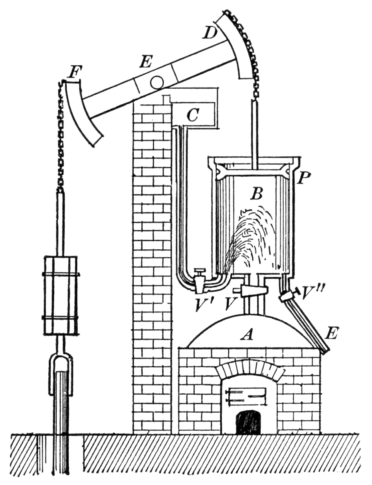

# Chapter 5 — How Disequilibrium Builds a New Pathway

At Fowey Consols in Cornwall the men who had just locked the coal shed put a seal on the door. They had seen the shed empty and measured the twenty-eight bushels that went in. Nobody wanted an argument tomorrow about who else might have had a key. They also sealed the two counters that recorded the strokes of the engine. One showed 660. The other showed 2,187,480. There was no difficulty about their disagreement. It was the difference between the readings now and the readings tomorrow that interested everyone.[1]

It was October 1834. The previous month’s figures for William West’s engine were so good that other engineers and miners had accused someone of cheating. Austen, the proprietor, had a reputation to recover. A bushel of coal, the report said, could raise nearly 98 million pounds of water through one foot. People who bought coal by the shipload had good reason to care whether that was true. Austen had invited them to come and see. John Pascoe of Herland and Mark James of Tamar Consols were among the pitmen appointed to inspect the pumps. The committee weighed a bushel, recorded the level of the water in the boilers, and checked the fires. The inventory extended to twelve pounds of grease and a quart of oil.[1]

At twenty minutes to eight that evening a component of a pump bucket broke. The Lilly lift stopped raising water. The beam overhead kept rocking, the other lifts kept pumping, and both counters went on counting. The broken bucket changed what a stroke was worth to the mine.[1]

## What the first bushel bought

A hundred and twenty years earlier the pressing question about an English pumping engine had been whether it could do enough work to get anybody underground at all. Thomas Newcomen and John Calley had an engine at work by 1712 near Dudley Castle. It was an atmospheric engine. Much of the force that lifted water from under the Midlands came from the air over the county that morning.[2]

The pump rods hung down the shaft from one end of a beam. At the other end a piston rose and fell inside a cylinder open at the top. The weight of the pump rods pulled their end down while the piston rose. Steam filled the space underneath it. Inject cold water and the steam condensed, leaving very little pressure on the underside of the piston. The air above it could now push it down. Across the beam the rods rose and brought water up the shaft. Open the way for fresh steam and the rods could drop again. People had long known the weight of a rod. The machine had given them a way of putting the weight of the atmosphere on the other end of the beam.[2]

*A Newcomen atmospheric engine. The piston on the right descends as the pump rod on the left rises. Black and Davis, 1913.* [Plate credit](../assets/images/README.md#newcomen-engine)

There was an expensive catch. The cold water cooled the metal of the cylinder along with the steam. When the next charge of steam entered, part of it turned straight back into water on the cold wall. A fair portion of the work of the fireman was devoted to remedying what the engine had done to itself on the previous stroke. Who, given a choice of places to put one, would choose to run such a machine?

In 1744 the natural philosopher J. T. Desaguliers pointed to a heap one could find at collieries. An engine could burn waste coal that the owners had no prospect of selling. The distinction between the coal in the heap and the coal the owners hoped to sell from the lower seam is almost the whole story of the invention. The heap could pay for an afternoon of indifferent pumping, then another. The rich seam under water could offer the men no such assistance. The old mine had already paid the cost of getting the heap to the surface. For a time it could support a second mine taking shape beneath it.[3]

A much older finding clarifies what a reserve changes. Ian Kuijt and Bill Finlayson excavated granaries at Dhraʿ in the Jordan Valley with raised floors that provided for ventilation and protection of stored food. The buildings predate fully domesticated crops. The finding establishes that a community could organize the custody of food across a gap in time before it had become dependent on domesticated grain. At a colliery the equivalent gap ran from committing fuel to gaining access to another seam. The source of the first surplus matters in both histories.[4]

Carlisle Spedding’s shaft at Saltom gives the argument a section one can still trace. On one side of the partition the pumps consumed fuel to raise water. On the other, horses wound up coal. The coal ultimately traveled to Whitehaven Harbour after storms spoiled the plan to ship it straight from the pit. Here was an engine making coal available to fires it would never feed directly. The route to market belonged inside any calculation of what its own fire accomplished.[2][3]

**At a flooded colliery, a steam engine can be the fastest way for coal to burn.** The relevant quantity is the fuel made available to the district over time. Burning waste coal at the shaft gave crews a way to reach marketable coal below the waterline. Coal could then reach more furnaces and household grates. The argument depends on the water and the outlets for the coal. At Saltom a pumping house survived a failed harbour. Tang Tingshu later put a price on precisely that distinction in northern China.[2][3]

## Three hundred carts

For an idea of why the geography of that story matters, consider what a potter could do with heat after it had done its first job. Robert Allen describes an English kiln in which the hot gases passed around the pots and escaped, and a Chinese one that sent them on to heat another chamber. Extra brickwork cost money. So did the fuel saved by putting it there. A potter who built one kind of kiln could be every bit as attentive to waste as a potter who built the other. They had different bills. Allen argues that in parts of Britain cheap coal and relatively costly labor made a coal-hungry engine a plausible early investment. Jane Humphries has asked whose labor enters the wage in that calculation. Women and children often worked for much less than adult men. A national average can make a poor guide to the particular person a proprietor could hire to do a particular job.[3][5]

It is tempting to set England on one side of a ledger and China on the other, write *steam* and *hands* over the columns, and think we have explained the difference. One Chinese mining district gives us the opportunity to walk from one column to the other without leaving the shaft. In a survey reported in 1878, the businessman Tang Tingshu described small workings in the Kaiping district of northern China. A pit could follow the coal until water came in, fill with mud and be abandoned. The men who sank the next pit already knew how to work one of that kind. Tang followed the coal from a proposed larger mine out to the road.[6]

To move the proposed output would take about three hundred large carts a day. There were too few carts. An order on that scale would itself raise the cost of hiring the ones available. Tang costed the journey to market both by traditional carriage and with a railway. His transport estimate changed the question. A mine that could raise more coal tomorrow would need a town prepared to receive it tomorrow too. So long as the existing pits and carriers could make a living together, a good pump on its own could be a bad investment. This is the proposed *metastability* of a system relying on familiar labor. It can settle back into a way of working that people know how to keep going, even when a different arrangement of pits, engines and transport could eventually produce more.[6]

By 1883 a visitor to Kaiping could report on a colliery served by a railway and a canal, with heavy engine-driven pumps to deal with water. Where the rock was hard the crews used mechanical drills. Where it gave way more readily, men worked the shale by hand because that was cheaper. Follow the drill across that boundary. Its usefulness changes before the workers have had time to acquire a different culture. These are late Qing records, a century and a half after the engine near Dudley. They show what could hold an arrangement in place and what had to change before another could pay. A history of the first steam engines needs evidence at that scale. From the earlier pits we would want Tang’s kind of arithmetic for the costs of lifting, carrying and selling coal.[6]

Whether a pair of hands is available depends a good deal on who gets to decide where its owner will work. In 1850 two men in Memphis, Samuel Rembert and Jedediah Prescott, patented a machine for picking cotton from the standing plant. Its wheels were to straddle a row while toothed disks worked among the bolls. In 1869 a planter in Winnsboro, South Carolina, wrote to *Scientific American* appealing for precisely the service the patent offered. T. W. Woodward had grown more cotton than he could get in for three years running, even after hiring all the help he could find. He wanted an inventor to solve a problem for which an inventor could already have shown him a drawing.[7]

In the intervening years the Confederacy had lost the war and enslaved people had gained their legal freedom. Under slavery a planter could command a picking crew, sell what it gathered, and use the proceeds to buy more land and more people to send into the rows next season. That dreadful capacity for renewal is a form of what this book calls *autopoiesis*. A device in a patent office could coexist quite comfortably with it. Emancipation broke the planter’s legal power to compel that return. Woodward’s published letters give us his reckoning of what had happened to the supply of hands. We also have a reckoning from someone who had once been counted as a pair of hands.[7]

In August 1865 Jourdon Anderson, by then living in Ohio, answered a request from the Tennessee man who had enslaved him to come back to work. Anderson wanted to know the wages. He was receiving twenty-five dollars a month in Dayton, his children were attending school, and his wife Mandy wanted evidence that a promise from their former enslaver was worth anything. They proposed a settlement for their previous labor. Thirty-two years of his work and twenty of hers came, by Anderson’s arithmetic, to $11,680 before interest. He was willing to allow deductions for specified expenses, including the pulling of a tooth for Mandy. Woodward and Anderson never needed to meet to have something to say to one another. A planter saw hands missing from a field. One family could tell you where those hands had gone, what they earned on Saturday and what it would cost to bring them back.[7]

A shortage on the planter’s terms intensified the search for a machine. Woodward said his appeal brought hundreds of letters. Some correspondents claimed to have a picker. Others wanted to know how picking was done. A cotton plant will tell an inventor one troublesome thing in its own time. Its bolls open on different days. An experienced picker can take the ripe cotton and leave the rest for another visit. For decades sharecroppers and hired workers continued to gather the crop by hand. Machines able to compete in these fields spread widely only after the Second World War. Even around 1963, a photograph at Magnolia Plantation in Louisiana shows Atrice Anthony picking the early cotton by hand. The machine went through when more of the crop was ready. A design had been on file before emancipation. The war altered who could decide to go into a row. The bolls kept their own calendar.[7]

## An object under the table

Cornish copper and tin mines presented a different fuel account. Much of their coal came by sea from Wales. The product of a metal mine paid for firing only after a sale and a delivery. Every charge wasted warming the cylinder had made a sea voyage. The same defect that a colliery could tolerate gave a Cornish owner a reason to finance a different engine.[8]

James Watt’s friend John Robison recalled finding him sitting by the fire with a small tin vessel on his knee. Watt set it down. As they talked, Robison looked at it and Watt pushed it under a table. It was a model of a separate condenser. We know rather more about the object than its maker was inclined to let on to his visitor that day. The Science Museum still has early models of the device.[9]

A steam cylinder has excellent reasons to be hot when fresh steam enters it. A place where steam is to condense has equally good reasons to be cold. The old pump made one metal wall serve both purposes. Watt gave the steam somewhere else to go. Open a passage to a cold vessel and the steam can condense there, while the cylinder stays hot for the next stroke. These are the material and Platonic sides of one piece of ingenuity. Where condensation occurs in relation to where the piston moves is a fact you could represent on paper. A poorly made joint between the vessels can wipe out the reward for having drawn them in the right places. Watt and the people who worked with him spent years getting the idea from the model to machinery that earned its keep.[2][9]

We have now seen two ways of getting over the same difficulty. Cheap coal let a mine *spend more* on getting water out before anyone knew how to do it well. Watt’s arrangement let a crew do the job on *less*. A history written backward from the separate condenser can make the early mine look like a careless place waiting for a competent engineer to turn up. The mine’s ability to pay for those wasteful strokes gave a generation of builders an engine that ran, and time to learn what might be improved. In industrial chemistry there is a comparable distinction. A catalyst helps nitrogen and hydrogen react at a useful rate. Building the equipment to compress and circulate them takes power and capital even after a chemist has identified the catalyst. Each improvement changes what it is worth building next.[3][9][10]

The Cornish crews altered the pressure at which they admitted steam and how much of the stroke they let it complete by expansion. Beginning in 1811, Joel Lean published monthly tables backed by mine proprietors. Readers could compare the *duty* of their engines, the estimated weight of water each could raise one foot for a bushel of coal. For years the tables left out the boiler pressure and the point at which the engineer cut off the supply of steam. A proprietor could consult a printed page to find the engine house doing exceptionally well. There were still good reasons to visit it.[8]

West had been deputy engineer under Samuel Grose at Wheal Towan. A young engineer could carry what he learned from one mine to a second. A published number could give someone in a third mine a reason to go and learn from him in turn. If you want to know how one Cornish engine came to have descendants, West’s apprenticeship is a good place to begin. The crew of an operating mine gets paid and somebody learns the work. A number travels with the firm’s name attached. A proprietor who expects to save coal pays for the next construction. An order for a pump can keep the people capable of making pumps available for a third order. Each link has a cost, and in a season of low copper prices the chain can break.[1][8]

## What the witnesses signed

Eventually the gentlemen at Fowey Consols opened the counters. Their own now read 6,947. Lean’s read 2,193,767. Either subtraction gives 6,287 strokes. The Lilly lift had been out from 7:40 until 10:23 that evening. They allowed three whole hours of lost work for that lift. The stroke length varied a little, so they used the shortest length they had observed. They went back to the coal shed. Four bushels of the original twenty-eight remained, and they checked the fires and the water in the boilers against their condition at the start. You could flatter an engine by handing it a generous fire to start on and letting the next shift pay to build it back up.[1]

With the deduction for the broken bucket, the committee credited the engine with raising **125,095,713 pounds one foot per bushel** during the trial of twenty-four hours and twenty-seven minutes. Now a mine owner had a choice of figures. September’s nearly 98 million, which had provoked the accusations, might tell him more about the coal he ought to order for a month of ordinary work. The six-month average reported by Lean was just under 90 million. The larger figure answered the detractors’ question about what the machine could do. The smaller ones could keep a proprietor from putting his name to a very foolish coal contract. The report gives the names of the pitmen as well as the signatures of the committee. The counters agreed to the last stroke. It still took the men at the Lilly lift to tell the chairman what a stroke had been worth.[1]

A few miles east of Cornwall the same atmosphere that worked the piston at Dudley took on a rather more public job. In the summer of 1848 a passenger could leave Exeter for Newton on a train drawn by air pressure. A pipe ran between the rails. Pumping engines ahead removed air from it. The higher pressure behind a piston drove it down the pipe, pulling a carriage by a bar through a slot along the top. A leather valve opened for the passing bar and closed behind it. To a passenger arriving at Newton the strongest evidence in favor of the scheme was the unremarkable fact of being in Newton.[11]

Isambard Kingdom Brunel had to look at a different piece of evidence. The leather had blackened and torn in places where the edges of iron plates came together. Air leaking in had to be pumped out again. A pumping engine the company wanted to stop and improve might have to go on running because the line already needed all the pumping it could get. In his report that August, Brunel considered whether a new valve would be worth its considerable cost and who would guarantee it. The directors offered the promoters the use of the machinery if they would continue the experiment at their own expense. In September locomotives took over. Part of the old pumping house at Starcross eventually served as a shed for locomotives. The railway kept the paying passenger.[11]

One mine spent a fortune on coal shipped from Wales and found it worthwhile to keep improving its engines. One railway sold tickets for a journey it could continue to provide while abandoning its pumps. In either case we can follow the return as far as the people with the authority to order a new part. That is what the claim about energetic selection asks of us. A better Cornish engine might save coal for the same work or open a deeper mine that consumed coal for another generation. Its duty tells us the work per bushel. For the stronger claim about a *maximum rate of entropy production*, we need the fuel consumed over time throughout the system, its ultimate fate, and the other routes open to those same mines. Someone who kept only West’s record figure would have thrown away a good deal of the evidence.[1][8]

The witnesses at Fowey Consols could take some things for granted. After a night in the engine house the weight of the water still bore the same relation to its mass, and a foot was still a foot. From such dependabilities people had constructed a pump, a system of reports and a persuasive answer to an accusation of fraud. Could the physical dependabilities themselves have come into being? West’s first materials had a history in the mines and workshops of Cornwall. For the materials, the rules and even the first difference from which a universe could draw work, there is no older workshop to consult.

## Chapter notes

1. The committee’s signed account records the September claim, witnesses, seals, counter readings, broken component, allowance and duration of the October trial. William Pole also recounts West’s experience under Grose. See §84, pp. 65–68 of [*A Treatise on the Cornish Pumping Engine*](https://www.e-rara.ch/download/pdf/12665405.pdf) and Thomas Lean’s [*Historical Statement*, pp. 96 ff.](https://books.google.com/books?id=tOsDAAAAQAAJ&pg=PA96). Pole reproduces both pairs of readings and the estimates for individual lifts. Lean gives the six-month average alongside the result of the short trial on p. 99. [S146](../research/sources.md#s146)

2. For Saltom see the [archaeological records](../research/sources.md#s157). The 1712 engine near Dudley is an early documented installation. For its builders, working cycle and drawings, see the [Black Country Living Museum’s account](https://bclm.com/wp-content/uploads/12-CIS-Steam-Power-The-Newcomen.pdf), the [engineering landmark description](https://www.asme.org/wwwasmeorg/media/resourcefiles/aboutasme/who%20we%20are/engineering%20history/landmarks/70-newcomen-engine.pdf) and the [Science Museum’s Newcomen model](https://collection.sciencemuseumgroup.org.uk/objects/co8231705/replica-of-model-of-newcomen-engine). [S36](../research/sources.md#s36)

3. Robert C. Allen reproduces the Desaguliers passage from *A Course of Experimental Philosophy*, vol. II, and compares English and Chinese kiln designs. Desaguliers describes fuel use at coal workings in general. The particular fuel bills for the Dudley engine are unknown here. See pp. 211–212 and 217–218 of Allen’s [British Academy lecture](https://www.thebritishacademy.ac.uk/documents/2079/pba167p199_0.pdf) and his [article on British industrialization](https://doi.org/10.1111/j.1468-0289.2010.00532.x). [S04](../research/sources.md#s04) · [S66](../research/sources.md#s66)

4. Ian Kuijt and Bill Finlayson describe the granaries and their suspended floors at Dhraʿ. The comparison with fuel held at a colliery is the book’s. [Archaeological report](https://doi.org/10.1073/pnas.0812764106) · [S35](../research/sources.md#s35)

5. Jane Humphries examines wages, household composition and the availability of female and child labor in [“The lure of aggregates and the pitfalls of the patriarchal perspective”](https://doi.org/10.1111/j.1468-0289.2012.00663.x). [S37](../research/sources.md#s37)

6. The 1878 dispatch transmits an account of Tang Tingshu’s survey. Three hundred carts was his estimate for increased output. In 1883 U.S. consul James C. Zuck described the transport links and the different uses of hand labor and drills. These are observations about Kaiping in the late Qing period. They illustrate the proposed switching costs. They cannot identify the cause of the earlier British invention. [Kaiping survey](https://history.state.gov/historicaldocuments/frus1878/d90) · [Zuck’s report](https://history.state.gov/historicaldocuments/frus1883/d78)

7. The [Rembert–Prescott patent, September 10, 1850](https://patents.google.com/patent/US7631A/en) describes picking from standing plants. For the change in legal authority, see the [Thirteenth Amendment](https://www.archives.gov/milestone-documents/13th-amendment). The Winnsboro grower described his own harvests in [“Cotton Picker Wanted,” July 1869](https://www.scientificamerican.com/article/correspondence-1869-07-24/). The [December correspondence](https://www.scientificamerican.com/article/correspondence-1869-12-04/) records the response from inventors and the comparison with slavery from a grower’s perspective. The Anderson family’s wages, schooling, back-pay calculation and deductions come from [Jourdon Anderson’s letter of August 7, 1865](https://pressbooks.nvcc.edu/ushistory2/chapter/letter-from-jourdon-anderson/), printed that year in Lydia Maria Child’s *The Freedmen’s Book*. For the later machines, harvest labor and the photograph of Anthony, see the [Smithsonian’s 1943 picker](https://www.si.edu/object/international-harvester-mechanical-cotton-picking-machine%3Anmah_857080), the [postwar regional study](https://www.cambridge.org/core/journals/social-science-history/article/abs/labor-markets-regional-diversity-and-cotton-harvest-mechanization-in-the-postworld-war-ii-united-states/73E0C9B3BFA5E87CE9FFDE29EFD99381), and the [National Park Service account of harvesting at Magnolia](https://www.nps.gov/places/farming-transitions.htm). [S44](../research/sources.md#s44)

8. Alessandro Nuvolari and Bart Verspagen reconstruct the Cornish fuel trade, expansive engines, monthly reports, omissions from the tables and exchange of practical knowledge in [“Unravelling the Duty”](https://pure.tue.nl/ws/portalfiles/portal/2303996/612886.pdf). The period account by Dionysius Lardner describes the reporting system in §178 of [*The Steam Engine Explained and Illustrated*](https://www.gutenberg.org/files/42602/old/42602-h/42602-h.htm). The interpretation of reusable skills and parts also draws on Arthur and Polak’s [model of cumulative technological invention](../research/sources.md#s60). For the distinction between work per fuel and rates of entropy production, see [Chapter 2](02-the-gradient-and-the-barrier.md#where-the-heat-goes). [S146](../research/sources.md#s146)

9. Science Museum curator Ben Russell quotes John Robison’s recollection and identifies the first and second condenser models in the collection. [Robison’s account and the surviving models](https://blog.sciencemuseum.org.uk/james-watt-and-the-separate-condenser/) · [Watt’s second separate condenser](https://collection.sciencemuseumgroup.org.uk/objects/co50928/watts-second-separate-condenser-1765-condensers) · [S36](../research/sources.md#s36)

10. Fritz Haber describes catalytic synthesis and Carl Bosch the engineering of industrial high-pressure equipment. [Haber’s Nobel lecture](https://www.nobelprize.org/uploads/2018/06/haber-lecture.pdf) · [Bosch’s Nobel lecture](https://www.nobelprize.org/prizes/chemistry/1931/bosch/lecture/) · [S39](../research/sources.md#s39)

11. Brunel’s report of August 19, 1848 describes the leather he examined, the pumping engines’ fuel consumption and the terms on which he thought renewal might be justified. The directors’ decision and the change to locomotive haulage follow the report in chapter VI of his son’s biography. [Report and directors’ decision, pp. 158–164](https://www.gutenberg.org/files/41210/old/41210-h/41210-h.htm) · [Manuscript record, University of Bristol Brunel Collection](https://archives.bris.ac.uk/Record.aspx?id=DM162%2F10%2F2%2Ffolio+316-324&src=CalmView.Catalog) · [Historic England, Starcross pumping house](https://historicengland.org.uk/listing/heritage-gateway/results/record/c39bc47e-3b72-4a06-9863-681629e456a2/MDV10259)

---

[← The Discovery That Became Possible](04-the-discovery-that-became-possible.md) · [Contents](../README.md) · [From Uncertainty to an Assembled Universe →](06-from-uncertainty-to-an-assembled-universe.md)
