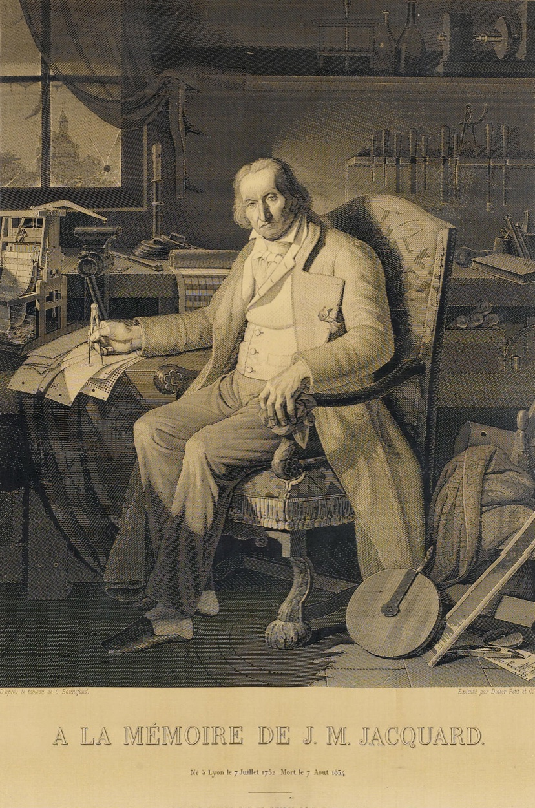

# Chapter 8 — The World That Learned to Think

At half past two on August 24, 1841, a son of the king of France visited a silk weaver in Lyon. We know the hour because two years later the weaver paid a painter five hundred francs to make a picture of the occasion. In the picture Michel-Marie Carquillat is showing the duke something he has made, a portrait of Joseph-Marie Jacquard. The duke and his company stand before a loom. When the painter had finished his part of the commission, Carquillat went to work. He wove the visit.[1]

There are thus two pieces of silk to look at. In the earlier one, Jacquard sits alone, a drafting compass in his hand and a length of punched cards hanging from the table. In the later one, a group of people has assembled to admire the earlier one. Carquillat wove them both. Under the later picture there is room for the name of the weaver, the painter, the man who drew up the pattern, the general, the prefect, the mayor and the president of the labor council. Under the earlier one you can find the painter and the manufacturer. Where are the other people who put Jacquard in his chair?[1][2][3]

*Michel-Marie Carquillat wove this first portrait in 1839, after a painting by Claude Bonnefond and a squared pattern prepared by J.-L. Moulin.* [Plate credit](../assets/images/README.md#jacquard-portrait) · [See the 1844 workshop scene at the Louvre](https://collections.louvre.fr/en/ark%3A/53355/cl010101072)

One of them left an answer. In 1895 a former pattern designer, J.-L. Moulin, corresponded with Antonin Terme, director of the textile museum in Lyon. Moulin recalled asking for a few small letters at the lower right of the portrait. François-Didier Petit, his employer, wanted the name of the firm there. Moulin said the refusal decided him to go and work for another house. Petit kept the credit on the silk. Another house got the designer.[2]

The second silk gives us a practical way to judge Moulin’s claim. The old cards could still produce Jacquard. They could not produce a duke visiting a workshop. Carquillat had to commission a new composition and find someone to solve the pattern again. The demand for this second picture locates an act of invention between the painter and the shuttle that looking at the first picture alone could easily conceal.[1][2]

## Making black with brown

Moulin’s opportunity came with the French industrial exhibition of 1839. Petit’s firm wanted something to exhibit. In Moulin’s recollection, he proposed using Jacquard’s device to reproduce Jacquard’s likeness. Claude Bonnefond had already painted him from life. The painter gave permission for a tracing. With the canvas taken down and Bonnefond watching, Moulin got what he needed on paper in a few hours. Then he worked for two and a half months. Joseph-Victor Vibert, an engraver who knew the picture, lent a drawing and came by to see how the work was going.[2][3]

One might reasonably have expected those times to run the other way round. Getting the dead man’s likeness sounds like the hard part. Once you have it on paper, what remains to do but copy it?

Look at the curtain in the upper left corner. The window frame is visible through it. To make that effect with a brush, a painter can vary the amount of dark pigment wherever he likes and stand back from the canvas to see how his curtain hangs. Carquillat had to get the effect out of crossings of thread. A warp runs the length of the cloth. The weft goes back and forth across it. What we see on the surface depends on which thread crosses in front of which and how far it stays there. Our eyes, from a little way off, put those small differences together. Enough of them in the right places and we see one material through another. The window behind the curtain and the curtain in front of the window have been made on the same surface.[3][4]

Moulin had a more immediate spectator to consider. Someone was going to bend over his drawing and count. He worked on ruled paper, laying in the darkest areas with brown wash. Had he used black where he wanted black on the silk, the black lines of the grid would have disappeared. He explained the choice in a note on the drawing that came to the museum. It is an excellent prescription for a particular kind of fidelity. To give the viewer a convincing black he had to give the card maker a brown that left every line visible.[2]

Each horizontal space could now be read, beginning at the bottom of the drawing. From those readings the card makers punched the selections that would bring the design up on the loom. Lace the cards in sequence and bring the first against the ends of the needles. Where there is a hole a needle can enter it. The solid part of the card pushes others back. This determines which hooks engage when the mechanism rises, and hence which of the associated warp threads rise with it. The weaver passes the weft through the opening. Another card comes forward. By the time a viewer has a patch of gray to admire, a great many choices have been made about things that could go only one way or the other.[2][4]

The squaring, reading and punching spare each worker the impossible task of guessing an entire face in advance. Someone who knows how to read the grid can settle the next few selections without working out what a French inventor’s expression ought to be. Someone who can set up the loom can make use of the card sequence without consulting Bonnefond. Each can rely on decisions reached by people whose other skills they may lack altogether. And so a newcomer can start with something quite modest enough to learn, the way to read a row, and still take part in making a picture that once defeated a member of the Royal Academy.[5]

The punched card carries a relation whose preservation took work. A counted position on the drawing had to correspond to a hole or an unpunched space, then to a needle in the loom and a selection of threads. The face survives these changes of material because the correspondence holds. I call that its Platonic character. Paper, card and silk each have properties of their own, and an error in the spacing of the needles would have consequences visible all over the silk.[4]

A visitor to Charles Babbage’s drawing room could admire the result without discovering any of this. The painter David Wilkie tried his best. A later visitor, Prince Albert, immediately recognized that it was a woven picture when the Duke of Wellington took it for an engraving. Babbage recalled being impressed for a moment. Then the prince volunteered an advantage he had enjoyed over the duke. He had seen it before.[5]

## Four hands at one loom

There is better evidence for how a weaving skill passes between people than any nineteenth-century portrait can supply. In 1970 Patricia Greenfield recorded nine-year-old Katal Pavlu at a loom in Nabenchauk, a Zinacantec Maya community in Chiapas, Mexico. At first Katal was working alone. Her mother came over without being called and began helping with the weaving. One still from the film shows four hands engaged at once. A finished piece of cloth would preserve the pattern beautifully. It would give a poor account of what those four hands had accomplished together.[6]

Twenty-one years later Greenfield recorded Katal’s daughter Loxa Santis at about the same age. The person available to help was her older sister Xunka’ Santis. Loxa had to call her several times to get her attention. In the first film an adult recognized a moment when help was needed and supplied it. In the second, making that judgment had become part of the younger weaver’s job. The loom had carried a practice across a generation in which the meaning of knowing how to weave had itself changed.[6]

Greenfield, Ashley Maynard and Carla Childs compared the other recordings as well. Childs went back through the earlier tapes so that a change in what she counted as helping would not masquerade as a change in the families. Assistance with difficult steps generally became less continuous. The researchers connected the shift with the growing place of selling textiles in family life. That is their historical explanation. The films establish something finer than anyone’s opinion about whether commerce made the weavers independent. They show who had to notice that help was needed and who did the asking.[6]

The difference reached the designs. Greenfield returned in 1991 wearing a red-and-white shawl and the clothes she had worn on her earlier fieldwork. At a roadside shop she found embroidery and woven borders quite different from those she remembered. The women’s blouses had kept their cut while designs proliferated across them. Her own clothing had inadvertently become a dated specimen. Continuity of the trade had made transformation possible. A practice capable of producing another weaver need not produce another identical blouse.[6]

Even a red stripe could contain different kinds of knowledge. In the earlier work, Childs and Greenfield asked participants to render familiar patterns in a frame with colored sticks of different widths. Some participants grouped thin sticks to render a broad stripe, preserving the fact that it was made of many threads. A broad stick could give much the same appearance. The distinction mattered as soon as the task changed from recognizing a garment to working out how it was woven. Moulin had confronted the same difference in using brown to make a convincing black.[2][6]

James Crutchfield and Karl Young gave a precise account of what makes an observed distinction worth retaining. Two histories can be grouped for prediction when they give the same probabilities for what follows. The weavers’ representations make the qualification tangible. A drawing that preserves enough to recognize the garment can discard the information needed to pick out its next thread. What counts as useful knowledge depends on what the possessor has to do with it.[6]

In Lyon a loom could preserve a long sequence of selections after everyone who had drawn them went home. In Nabenchauk, a skilled helper could take an initiative that Loxa was only beginning to exercise for herself. At both places the cost and the benefit of instruction fell at different times. The learner needed access to the work while another person could already do it. A trade that allowed no such access would have a way to fill existing orders and a dwindling number of people able to take the next one.

Michael Muthukrishna and Joseph Henrich call the resulting capacity a *collective brain*. Its strength is the division of memory and judgment among people in contact. Moulin could build on Bonnefond’s decisions about the face and Carquillat could build on Moulin’s. Loxa could try a step on her own with Xunka’ still within calling distance. The social relation changes the cost of the next attempt. That is a more exact claim about collective intelligence than adding up what each person knows separately.[7]

The two films in Nabenchauk also show what happens after a skill has been acquired. Katal’s family produced another generation of weavers. I use *autopoiesis* for that part of the story, in which carrying on a practice helps bring new practitioners into being. The family’s more remarkable achievement was to hand down a practice its members could change. Loxa was learning to judge when she needed help in a trade that was also making different kinds of cloth. In Lyon, a signed receipt lets us follow a weaver’s new freedom to choose a subject.[1][6]

Something similar had happened when a table and diagram from Cleveland put years of Michelson and Morley’s work within Poincaré’s reach in France. What traveled was a result. A new use for it depended on what someone at the far end could already do. Lyon has left examples of both the result and the working knowledge that could travel with it, in different states of preservation.[8]

## The half of a drawing that came home

When the Paris jury saw the first portrait in 1839, it praised the firm for applying Jacquard’s invention to the celebration of its inventor. That is just about the transaction a manufacturer might have wanted. A future customer could read the name of the firm in the corner and know where to send the next commission. The transaction as Moulin remembered it had one further consequence. That customer might have to go to another house to find him.[2]

Marx used the term *general intellect* for knowledge acquired in common that becomes a productive power. A firm can own machinery in which some of it is lodged. It can put its own name on the article and receive the order. How much of the productive power did it buy? The first silk lets us give an unusually exact answer in one respect. Once the cards were made, neither Moulin nor Bonnefond had to come in and draw Jacquard again for each new buyer. To introduce a new face, the proprietor would again need somebody who could do what Moulin did. A small space in the lower right corner seems a modest price to have been asked to pay.[2][9]

Years afterward Moulin wanted a copy of his design. He had his own draftsmen by then. Carquillat had the old drawing and agreed to lend it. Four draftsmen worked with Moulin to copy the upper part. Before they could finish, the original was called back. Moulin told the museum director he had never managed to establish who owned it. The original is lost. A copy made by a man obliged to borrow his own work is how we know what his brown wash looked like.[2]

It is worth asking what a city had succeeded in preserving over that interval. Several examples of the silk survived. They can still give anyone the experience of seeing daylight through Jacquard’s curtain. In the museum in Lyon a person can look at the partial grid and see how somebody prepared to weave that daylight. To get the lower portion back from a finished example would once again mean employing people to solve a problem that had already been solved in the same city. There were people skilled enough to make the copy and someone quite willing to lend them the drawing. What ran short was the time for which they could keep it.

Now look again at the second silk. Below the picture of the duke in the workshop are the names of Bonnefond, who supplied the composition, André Manin, who prepared the pattern for this picture, and Carquillat, who wove it. Their places in the work are legible in the work itself. And a signed receipt survives. In July 1843 Bonnefond acknowledged five hundred francs from Carquillat for the composition that Carquillat intended to weave at his own expense. The weaver had become the person who could commission a painting, bring in a different pattern designer and put all three trades in the credits. It was possible to run this business more than one way.[1]

Among the dignitaries named under the 1844 silk is the president of Lyon’s labor council. The city’s weavers had another way of making that institution’s acquaintance. A woman could come before the council with nothing to exhibit and a perfectly precise account of what her work had been worth. Several months before the duke’s visit, a workers’ paper reported that Mademoiselle Pommet had done just that. She was owed forty francs.[1][10]

## Chapter notes

1. The Musée d’Art et d’Industrie in Saint-Étienne transcribes the inscriptions on the 1844 silk and Bonnefond’s signed receipt of July 18, 1843. It identifies the picture shown to the duke and gives the date and hour of the visit. The Louvre holds another example. The five hundred francs paid for Bonnefond’s composition. [French national museum catalogue, object 95.72.9 T](https://pop.culture.gouv.fr/notice/joconde/10230001974) · [Louvre collection record and image](https://collections.louvre.fr/en/ark%3A/53355/cl010101072)
2. The Musée des Tissus in Lyon holds Moulin’s partial copy of the drawing, MT 25800. Its catalogue gives Moulin’s retrospective account of obtaining the tracing, preparing the grid, asking to sign, changing firms and borrowing the original. His correspondence with Antonin Terme dates from 1895–96. The brown wash is explained in Moulin’s own annotation. [Lyon exhibition dossier, object MT 25800](https://www.museedestissus.fr/media/expositions/jacquard-point-a-la-ligne/jacquard-point-a-la-ligne_dp.pdf)
3. The Metropolitan Museum identifies the commission, the weaver and the effect of the curtain. The Henry Ford holds another example of the Jacquard portrait. [Metropolitan Museum of Art](https://www.metmuseum.org/art/collection/search/222531) · [The Henry Ford, 39.173.1](https://www.thehenryford.org/collections/explore/artifact/219008) · [S147](../research/sources.md#s147)
4. E. A. Posselt describes the needles, hooks, cords and cards of a single-lift mechanism. The Lyon museum documents the reading of the portrait grid from the bottom up. [Posselt, *The Jacquard Machine Analyzed and Explained*](https://www.gutenberg.org/files/54193/54193-h/54193-h.htm)
5. Charles Babbage recalled Wilkie’s successive guesses and Prince Albert’s explanation during a different visit, in 1842. See chapter XI, pp. 169–170. [*Passages from the Life of a Philosopher*](https://www.gutenberg.org/cache/epub/57532/pg57532-images.html) · [Babbage’s use of cards in the Analytical Engine](../research/sources.md#s148)
6. Greenfield, Maynard and Childs compare Katal and Loxa in figures 3–4 and describe how they coded the tapes. Greenfield describes her return to Nabenchauk, and her earlier paper illustrates the stick patterns. The connection to the predictive distinction is the book’s. [Family and film records](https://greenfieldlab.psych.ucla.edu/wp-content/uploads/sites/168/2019/01/31-pac2000.pdf) · [Return to the community](https://www.culturalsurvival.org/es/publications/cultural-survival-quarterly/weaving-generations-together-evolving-creativity-maya) · [Patterns and representations](https://greenfieldlab.psych.ucla.edu/wp-content/uploads/sites/168/2019/01/24-greenfield1999.pdf). James P. Crutchfield and Karl Young developed the formal predictive-state distinction. [“Inferring Statistical Complexity”](https://doi.org/10.1103/PhysRevLett.63.105) · [S125](../research/sources.md#s125)
7. Michael Muthukrishna and Joseph Henrich develop the social-learning and recombination account of cumulative culture. [“Innovation in the collective brain”](https://pmc.ncbi.nlm.nih.gov/articles/PMC4780534/) · [S12](../research/sources.md#s12)
8. Poincaré explicitly invokes Michelson’s result. The return from socially maintained knowledge to the physical work a community can carry out is the book’s hypothesis. [Chapter 4, sources and historical comparison](04-the-discovery-that-became-possible.md#chapter-notes)
9. In Notebook VII of the *Grundrisse*, Marx connects general social knowledge with productive capacity and fixed capital. [Manuscript text](https://www.marxists.org/archive/marx/works/1857/grundrisse/ch14.htm) · [S53](../research/sources.md#s53)
10. A separate report in the workers’ press records Pommet’s claim. It appeared in January 1841, before the duke’s August visit. [*L’Écho des ouvriers*, no. 12, Lyon municipal library](https://collections.bm-lyon.fr/BML_01PER0030214781/ISSUE_PDF)

---

[← The Species That Changed Its Own Conditions](07-the-species-that-changed-its-own-conditions.md) · [Contents](../README.md) · [The System That Produces Its Tomorrow →](09-the-system-that-produces-its-tomorrow.md)
