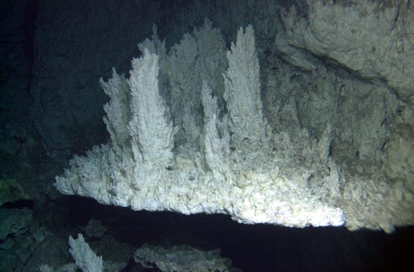

# Chapter 5 — From matter to life

Gretchen Früh-Green took the white branches for coral. She was watching a camera feed aboard *Atlantis* in December 2000. As the camera drew closer she recognized mineral deposits and went to fetch Deborah Kelley. Later, from the submersible *Alvin*, Kelley and Jeff Karson could see what moved beneath one of the ledges. A mat of microbes waved in a rising current of warm water.[1]

The expedition named the field Lost City. Where vent fluid met seawater, carbonate minerals had built the ledge a layer at a time. The same current that stirred the mat kept bringing it hydrogen from deep in the rock. Fresh stone could form wherever the two waters met. Each cell in the mat had come from another cell. How did a current that could build stone come to support something with descendants?[1][2]

*The branching ledge forms where vent fluid meets seawater.* [Expedition image credit](../../assets/images/README.md#lost-city-vent)

Three years before the dive, the geologists Michael Russell and A. J. Hall had placed the origin of life inside a mineral wall. Their early seafloor differed in one important respect from the white ledges of Lost City. Where iron and sulfide met in the ocean they described, iron sulfide precipitated around pockets of fluid. Warm alkaline water rising from the crust supplied hydrogen on one side. On the other, the seawater was more acidic and supplied dissolved carbon dioxide. Rock enclosed a space between the two waters before any cell had a wall of its own.[2]

## What a sample can remember

Heather Graham once gave colleagues a fragment of the Murchison meteorite and a sample of bay sediment without telling them which was which. Both could contain organic molecules. The investigators broke molecules into fragments to estimate how many different joining steps their construction required. A high count in material present in many copies could reveal a history of repeated production. When Graham disclosed the labels, even the sediment had scored low. A living source can leave little of its history in a particular sample. How does a site acquire a history it can pass on in the first place?[8]

## What crossed the wall

Reuben Hudson and his colleagues followed the carbon through one such reaction in the laboratory. On one side of a thin iron and nickel sulfide deposit they supplied water rich in hydrogen. On the ocean side they marked dissolved carbon dioxide with a heavier isotope of carbon. The mark turned up in formate, a small organic molecule. A second tracer showed that the hydrogen atom attached to that carbon had also come from the ocean-side water. What had crossed the wall? The results pointed to electrons. Hydrogen gave them up on the alkaline side and carbon dioxide received them on the other. When the researchers reduced the difference in acidity between the streams, formate fell below detection.[3]

A molecule of formate swept out to sea took its carbon with it. In a pocket where some products lingered, the next water had more to react with. The mineral also mattered. Working with hydrogen and carbon dioxide in contact with iron-bearing minerals, Martina Preiner and her colleagues recovered two-carbon acetate and, under a narrower range of conditions, three-carbon pyruvate. Cells today can use the three carbons of pyruvate together to make the amino acid alanine. A pore that retained pyruvate already had that carbon skeleton for its next reaction.[3][4]

This is the first level of the *hierarchical entropy rejection funnel* at a vent. The geometry of the reacting atoms restricts which bonds can form, a constraint in what the book calls *Platonic space*. A mineral surface brings some of those bonds within reach. Heat passes into cooler seawater and the outflow carries dissolved products away. A pore can accumulate a particular compound while the entropy of the pore and its surroundings rises. A change of level comes when something that stays begins to help make the next supply.[3][4]

## When one starting molecule becomes two

Eric Smith and Harold Morowitz found an example in the way some microbes build organic matter from carbon dioxide. They followed a four-carbon molecule called oxaloacetate through the reverse citric acid cycle. Over one circuit two more carbon atoms enter. At the end a six-carbon molecule splits. Four carbons return as oxaloacetate, ready for another turn. The other two leave together as an acetyl group. With further reactions that take up carbon dioxide, that two-carbon piece can become a second oxaloacetate. A sequence that began with one starting molecule now has two.[4]

Living cells use enzymes and couple the difficult steps to reactions that release energy. Smith and Morowitz asked whether a circuit of this kind could have run on minerals and simpler catalysts. In the early pore the current would have carried some of the four-carbon molecules away. Other reactions would have consumed some. While losses outran replacement the circuit would die out unless fresh starters came from outside. A little more time against the wall, or a steadier supply of hydrogen, could reverse the balance. Then the fluid arriving after one turn could find two starters where the previous fluid had found one. A gradual change in the flow could carry the chemistry across a sharp threshold. On one side the circuit died out. On the other it grew.[4]

Even a growing circuit still depended on one patch of rock. A current strong enough to empty the pocket could scatter its components. The next pore could be receiving the same feed and inherit none of what had accumulated.[4][5]

The shape of a pore gives *downward causation* a physical meaning at a vent. The same inflows can meet in open water, where a reaction product drifts away, or on opposite sides of a thin mineral wall, where fresh fluid keeps replenishing each side. In the second arrangement the wall can keep a catalyst in contact with new reactants long after the water carrying the old ones has gone. Change the wall’s permeability and even the reactions one molecule can take part in change. The sea carries away heat and spent material. Inside, something can accumulate. What would let that local achievement travel to the next pore?[2][4][6]

## What a daughter inherits

In a bent glass tube, Itay Budin and his colleagues saw how a pocket might acquire a boundary of its own. They kept one side of the tube warmer than the other. Water rose on the warm side and sank on the cool side. Dissolved molecules also drifted across that temperature difference. A quiet side arm at the foot of the tube collected fatty acids. Once enough gathered, their oily tails could pack against one another with their heads facing the water on either side. Sacs formed. The team washed the free fluorescent dye out of the tube. The sacs still glowed. They had enclosed some of the liquid that had been there before the rinse.[5]

Heat flowing across the tube had concentrated material. At the vent, hydrogen reacting with carbon dioxide could supply chemical work even after the water cooled. An early pore had to bring a boundary and a working chemistry together. Salt weakened the concentrating effect in Budin’s tube. With a different mixture of fatty acids and related alcohols, Sean Jordan’s team found that sacs could form even at the salt concentrations of modern seawater. Both groups supplied the molecules for the walls. An early vent had to make such molecules or gather them faster than the sea diluted them.[5]

A sac could divide before it had any way to copy what was inside. In Ting Zhu and Jack Szostak’s laboratory, a growing sac stretched into a long thread as it gained membrane. Gentle movement of the water broke the thread into smaller sacs. Fluorescent tags on short strands of RNA showed that daughters took a share of the strands with them. The researchers had supplied that RNA. A daughter that kept dividing the same stock would eventually have too little to pass on.[6]

In the proposed vent history, the decisive daughter inherited enough of its parent’s chemistry to start the cycle again. Its boundary admitted small molecules and kept the catalysts close enough to act on them. The reactions inside drew on the feed to replace catalysts and to make material for the wall. A strand that served as a template could carry a change in sequence into a granddaughter. If the change helped a compartment mend a leak before its catalysts escaped, more of that family could survive. How copying, catalysis and boundary growth first came to depend on one another remains open. Together they would have carried the funnel up a level. A pore could keep a molecule through a change of water. A daughter could keep a whole set of reactions through a change of pore.[4][6][7]

Earth had to cool enough for liquid water, fresh rock and a flow of hydrogen and carbon to persist together. Then many pores could run the same restricted reactions at once. As soon as a compartment left, on average, more than one daughter able to repeat its cycle, a population could grow. On this account life took hold in Earth’s first suitable interval. Preparing the seafloor took geological time. Once enough chemistry could pass from parent to daughter, the pace belonged to reactions and divisions. A zircon can tell us when water was present. The date of the first division is another matter. Chapter 15 brings those two clocks together.[7]

A bare chimney wall has only its own surface on which to catalyze a reaction. Daughters can occupy fresh pores where hydrogen would otherwise leave unused. Some of the chemical energy spent making a daughter can thus bring a fresh stretch of vent into use. That gain ends when the population runs short of hydrogen or of a partner to accept its electrons. The book proposes that, given the same inflow, the living route sustained the highest rate of entropy production available across the field. A comparison with bare rock must count the heat carried away and the chemical energy still leaving in cells and other products.[4][7]

The current beneath Kelley’s ledge fed a whole mat. The first daughter in this account could have settled one pore away from its parent. The rock still supplied the hydrogen. The daughter brought the means to make the next piece of its wall.[1][2][6][7]

## Notes

1. The expedition’s December dispatch records Früh-Green at the monitor. The shipboard account describes Kelley and Karson’s dive and the microbial mats moving under the ledges. [Expedition dispatch](https://earthguide.ucsd.edu/mar/dec12.html) · [Account of the dive](https://today.duke.edu/2000/12/alvind15.html)

2. Kelley and colleagues report carbonate growth and the chemistry of Lost City’s fluids. Russell and Hall proposed a sulfide boundary in a chemically different early ocean in 1997. The modern field supplies a geological analogue. [Lost City measurements](https://wbrazelton.github.io/papers/Kelley-Science/) · [Russell and Hall’s vent hypothesis](https://pubmed.ncbi.nlm.nih.gov/11541234/) · [The supply of hydrogen](04-from-hydrogen-to-gold.md#where-rock-makes-hydrogen)

3. Hudson and colleagues used carbon-13 and heavy hydrogen in separate runs. The carbon in formate traced to supplied carbon dioxide, and its attached hydrogen matched the water on the ocean side. The authors infer electron transfer across the deposit. Preiner and colleagues measured several carbon compounds in separate mineral experiments under different conditions. [Hudson’s isotope tracing and controls](https://doi.org/10.1073/pnas.2002659117) · [Preiner’s mineral reactions](https://pubmed.ncbi.nlm.nih.gov/32123322/)

4. Smith and Morowitz trace the fates of oxaloacetate and the two-carbon product in figure 3 and its discussion. They propose that an early network helped dissipate geochemical free energy. The experimental evidence for the individual steps leaves the complete ancestral circuit unresolved. [The carbon cycle and its balance](https://sites.santafe.edu/~desmith/PDF_pubs/PNAS-2004-Smith-13168-73.pdf) · [Energy flow and metabolism](../../research/sources.md#s140) · [Models of networks supplied by their own catalysts](../../research/sources.md#s123)

5. Budin, Bruckner and Szostak show the bent channel and the dye retained after rinsing in figure 2. Salt reduced concentration by thermal transport in their experiments. Jordan and colleagues tested membrane formation with mixtures at seawater salt concentrations. Each study supplies a different part of the physical argument. [The thermal trap](https://pmc.ncbi.nlm.nih.gov/articles/PMC2710859/) · [Vesicles in salt water](https://doi.org/10.1038/s41559-019-1015-y)

6. Zhu and Szostak traced the redistribution of short, supplied RNA strands during division in figure 3. Their model compartments did not copy those strands. In a separate model Lincoln and Joyce studied RNA catalysts that made one another from supplied fragments. Connecting heritable chemistry to repeated compartment reproduction at an early vent is a further step. [Growth and division](https://doi.org/10.1021/ja900919c) · [Mutually replicating RNA catalysts](https://doi.org/10.1126/science.1167856) · [Chapter sources](../../research/sources.md#s186)

7. The first-interval and maximum-rate claims are the book’s hypotheses. The comparison across routes includes heat and material flows under the same supply over the same interval. [Evidence for early water and life](15-fermi-paradox.md#immediate-evolution-on-a-ready-planet) · [Physical rates and comparisons](../../research/sources.md#s179) · [Production of a living boundary](07-self-reproduction.md)

8. Marshall, Mathis and colleagues report the blinded sample test and its limitations. [Blinded sample study](../../research/sources.md#s161) · [Assembly theory and the index](../../research/sources.md#s02)

---

[← From hydrogen to gold](04-from-hydrogen-to-gold.md) · [Contents](../../README.md#contents) · [Self Assembly →](06-self-assembly.md)
