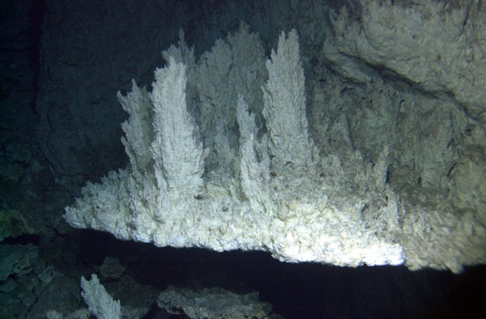

# Chapter 5 — The White Towers of Lost City

*Part I · Physics*

Gretchen Früh-Green went to fetch Deborah Kelley. A camera trailing behind the research ship *Atlantis* had picked out white branches on the side of an underwater mountain in the Atlantic. Früh-Green first took them for coral. As the sled drew closer she recognized mineral deposits. Back at the monitors, Peter Rivizzigno and Nick Bacher matched the edges of successive frames. Some of the towers in the mosaic rose fifty-five meters. The pictures could not settle whether anything still flowed through them.[1]

Kelley and Jeff Karson went down in *Alvin*. Below a thin mineral ledge, mats of microbes moved in a current of warm fluid. Patrick Hickey collected fluid and pieces of the towers. When the submersible came back to the surface, Heather Hanna helped preserve small animals that had been living in hollows in the rock. Hanna usually dealt with fossils. These specimens had come up alive.[1]

*The branching ledge forms where vent fluid meets seawater.* [Expedition image credit](../../assets/images/README.md#lost-city-vent)

The expedition called the field Lost City. It sits on exposed mantle rock. Seawater enters cracks and reacts with minerals in the rock. The water that returns to the ocean is warm, alkaline and rich in hydrogen and methane. Where it mixes with the sea, carbonate minerals precipitate. Each deposit gives the next one a surface on which to form. What looked like a colony of animals from the ship could be constructed by water and rock. The animals Hanna sorted had found homes in the spaces that construction left.[2]

## The next parcel of water

What can a living inhabitant get from this place? Hydrogen-rich fluid meets water with a different composition. Some combinations of reactants can release chemical free energy on their way toward equilibrium. They can also drift past one another and reach the open sea before much happens. Saying that a reaction pays does not say how to collect the payment. A pore can keep substances close. A mineral surface can help a particular reaction proceed. A catalyst can change which products are made during the brief time the fluid spends there.[2][3]

Reuben Hudson and his colleagues tested a piece of this proposal. Across a mineral barrier they maintained fluids of different acidity. Under their vent-like laboratory conditions hydrogen and carbon dioxide could react to produce formate, a compound useful in further chemistry. The group compared arrangements in which the difference across the barrier was changed. Supplying the reactants in the right relation mattered to obtaining the product. Formate is a carbon compound. Its production establishes a chemical step for which life itself need not already exist.[3]

Eric Smith and Harold Morowitz asked how much of metabolism might have such a history. Some pathways in modern organisms recur in widely different settings. In the reverse citric acid cycle, a sequence of reactions allows organisms to incorporate inorganic carbon into building material. Smith and Morowitz examined how the chemistry of the available intermediates might have narrowed the routes open before a lineage could inherit a list of instructions. A network in which one step keeps supplying the next has a practical advantage over an equally imaginable network whose ingredients wash away.[4]

A living boundary makes a further difference. It can admit some of what passes, hold on to useful products, and spend part of the return making more of the components that do the admitting. When a cell divides, a second place to carry out the same reactions enters the current. This is where life could become the most effective way for a vent to discharge available chemical energy. The first parcel of fluid can help pay for a catalyst that will still be there for the second. A population can put new catalysts into more of the available pores. An account of reaction rates that holds the amount of catalyst fixed from the beginning misses the advantage Smith and Morowitz had in mind.[2][4]

An optimum has to be earned. A bare mineral may process one stream faster than a cell could. Cells spend energy renewing their membranes and can use up a local supply faster than water brings more. To compare the alternatives we need the same inlet, the same time, what leaves each outlet, and the work spent maintaining the living population. The hypothesis is that under some early conditions metabolism offered the best sustainable route through the gradient, and that a share of the energy it released made the route more common. We have yet to measure that comparison for the first habitat on Earth.[3][4]

## What the rock can remember

There is an argument about origins hiding under the ledge. A modern cell has so many arrangements of parts that assembling one by drawing molecules out of a hat would take an absurd time. The water at Lost City has no such freedom. It arrives with a composition fixed in part by the rock it has already crossed. Products form in an order. What is retained changes the starting material for the next reaction. The enormous number of possible finished cells gives us little information about the waiting time in a pore through which fresh fluid keeps coming. It gives us equally little warrant for declaring that life must have begun in any particular pore.[2][3][4]

Two histories could produce living microbes on Kelley’s ledge. Their ancestors could have taken their first steps in a similar environment. They could also have originated elsewhere and occupied the vent after acquiring the means to use it. Finding the organisms settles which resources a living community can exploit today. To address the first appearance we will need other sorts of evidence, including a crystal older than most of the rocks left on Earth. The difference between possible and historical is the subject of a later chapter.

Hanna could take a piece of mineral from the ledge and preserve it by getting it out of the water. The animals in its hollows faced the opposite problem. They had to keep water, nutrients and waste moving while replacing substances that were wearing out. A wall of mineral can persist because little happens to it. A cell can persist because a great many things happen in the right order. In an early computer model of a cell, its builders gave the boundary one troublesome property. It could spring a leak.

## Notes

1. The December expedition dispatch and later interviews record the camera survey, dive and samples. [Lost City expedition](../../research/sources.md#s145)

2. Kelley and colleagues document vent chemistry, carbonate structures and the microbial and animal communities. [Field study](../../research/sources.md#s143)

3. Hudson and colleagues give the apparatus, controls and product measurements. [pH-gradient study](https://doi.org/10.1073/pnas.2002659117)

4. The optimal-channel interpretation belongs to Smith and Morowitz and is developed here as a hypothesis. [Energy flow](../../research/sources.md#s140) · [Metabolic pathway constraints](../../research/sources.md#s141) · [Planetary chemistry](../../research/sources.md#s142)

---

[← What Lights a Star?](04-what-lights-a-star.md) · [Contents](../../README.md#contents) · [Who Makes the Boundary? →](06-who-makes-the-boundary.md)
