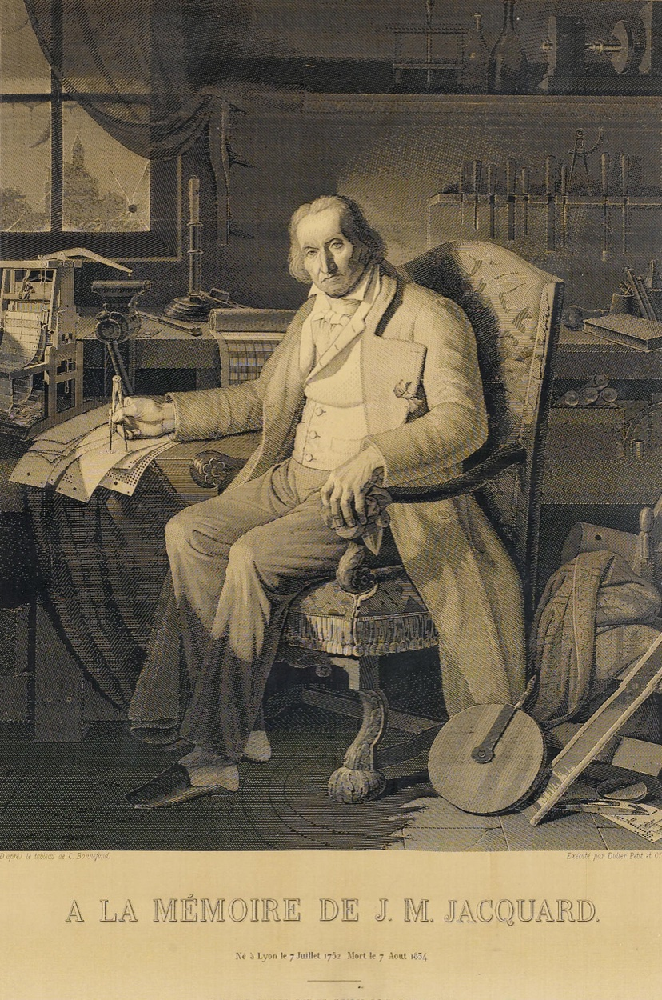

# Prologue — The Portrait Behind Glass

“Line-engraving, to be sure!” The painter David Wilkie stood a few steps from a portrait in Charles Babbage’s London drawing room. Babbage had asked him what kind of engraving it was. A line engraver cuts grooves in a plate. Press damp paper against the inked plate and closely spaced grooves print a shadow. Babbage brought him nearer. Wilkie suggested another engraving technique. Close to the glass, Babbage recalled, the painter paused. “Can it be lithography?”[1]

A curtain hung behind the man in the portrait. Through it Wilkie could see the window frame and a cracked pane. Curtain, crack and the light coming through the window were all woven into a single sheet of silk.[2]

*À la mémoire de J. M. Jacquard*, Lyon, 1839. [Plate credit](../assets/images/README.md#jacquard-portrait)

The man was Joseph-Marie Jacquard. A chain of punched cards spills over the edge of his table. Michel-Marie Carquillat used a chain like it to weave the portrait in Lyon in 1839. Each card selected which of the long threads, the warp, to lift as the shuttle passed. A dark thread could cross in front of a light one and then pass behind it. From where Wilkie first stood, those crossings looked like a crack in glass.[2]

J.-L. Moulin planned the crossings from a painting by Claude Bonnefond. Years later he wrote to the textile museum in Lyon about the few letters he had wanted to add in the lower right corner. His employer, François-Didier Petit, reserved that space for the firm. Moulin took a job with a competitor. Petit could still fill an order for Jacquard’s portrait. A new face would require someone who could do what Moulin had done.[2]

The firm could pass Moulin’s decisions to another weaver because each position on a card corresponded to particular threads. Replace a worn card with a copy and the correspondence survives. Change the spacing of the needles and the same holes call up the wrong threads. An *assembly*, as I use the word, turns available energy to a use its parts could never achieve separately. It is both material and *Platonic*. What the weaver’s labor can accomplish depends on a relation that can be carried from one piece of card to the next.[2]

Babbage was designing a calculating engine. He wanted a mathematician to be able to change a calculation after the wheels were built. A weaver could take out the cards for one picture and put in cards for another. Babbage proposed cards that would tell the same set of wheels when to add and when to multiply.[1]

The loom lets us see what a new arrangement adds. A harder question is why, of all the arrangements people might have made, they put their labor into a particular one. At a flooded coal mine we can follow that decision down to the price an owner paid for an engine.

In 1702 Thomas Savery had a steam pump to sell and an objection to answer. Carpenters made the winding gear for English mines. Who would order it once a machine raised the water? In a pamphlet for mine investors, Savery followed the carpenters’ trade down the shaft. A pit abandoned to flooding would never need another timber. Drain it and the men could dig deeper. The loose ground would need shoring up all the way down.[3]

He could offer the local carpenters one order himself. They could make the pipes for his pumps if they followed his directions and worked cheaply.[3]

At Whitehaven on the Cumberland coast, Sir James Lowther agreed in 1715 to pay £182 a year for a steam pumping engine. Horses already raised water for him. An engine could justify its rent by doing their work more cheaply. A different advantage arose when the water came in faster than the horses could raise it. An engine that could keep up would give miners a seam they could never have worked. There was coal at the pit to fire the boiler. At one of Lowther’s later pits, Saltom, miners brought up coal from beneath the Irish Sea.[4]

There was a reason to spend coal at a flooded shaft that did not apply at a dry one. Burning it could give the miners access to more coal. There was also a condition on that bargain. Until the pump raised water faster than it entered, the new seam supplied none of the fuel. The means to make the first working engine had to be found in the old mine.[4]

I argue that creation has a direction. A usable difference in energy and a constraint on how to reach it favor some arrangements over others. An arrangement that opens a larger flow can then put some of the gain into producing more of its kind. That gives its successors resources the first one had to do without. I expect this to help explain the emergence of life and artificial intelligence. I also suspect that the physical laws on which those histories depend were once taking shape. In that case even the origin of the energy differences is part of what we have to explain.[5]

People who build one thing also change what it makes sense for someone else to build. Once the miners at Saltom could work beneath the Irish Sea, they needed a way to get the coal to market. When storms damaged their little harbour, the miners sent it back underground.[4]

## Prologue notes

1. Babbage recounts Wilkie’s visit in chapter XI of his 1864 memoir, pp. 169–170. The painter’s words are as Babbage remembered them. In chapter VIII, pp. 116–118, he describes adapting the principle of the Jacquard loom for his proposed Analytical Engine. [Charles Babbage, *Passages from the Life of a Philosopher*](https://www.gutenberg.org/cache/epub/57532/pg57532-images.html) · [Babbage on the Analytical Engine](https://www.fourmilab.ch/babbage/lpae.html) · [Victoria and Albert Museum on printing an engraving](https://www.vam.ac.uk/articles/what-is-print)
2. The Metropolitan Museum identifies the weaver, painter, manufacturer and translucent curtain. The Library of Congress describes the cards and the damaged windowpane. The Lyon museum transcribes Moulin’s account of the credit dispute and his change of employer. [Musée des Tissus, notice for MT 25800](https://www.museedestissus.fr/media/expositions/jacquard-point-a-la-ligne/jacquard-point-a-la-ligne_dp.pdf) · [Metropolitan Museum of Art, *Joseph Marie Jacquard*](https://www.metmuseum.org/art/collection/search/222531) · [Library of Congress, *À la mémoire de J. M. Jacquard*](https://www.loc.gov/pictures/item/2002737214/) · [The Henry Ford, *Portrait of Joseph-Marie Jacquard*](https://www.thehenryford.org/collections/explore/artifact/219008) · [S147](../research/sources.md#s147) · [The grid and loom mechanism](08-the-world-that-learned-to-think.md#making-black-with-brown)
3. Savery addresses English mine investors at the start of his 1702 pamphlet. The work he promises carpenters depends on owners opening more mines. [Thomas Savery, *The Miner’s Friend*](https://www.gutenberg.org/cache/epub/46879/pg46879-images.html) · [S36](../research/sources.md#s36)
4. J. E. Ward identifies Lowther’s lease of November 19, 1715. The archaeological record traces the route from the pithead at Saltom to Ravenhill. [Ward on the lease](https://archaeologydataservice.ac.uk/catalogue/adsdata/arch-2055-1/dissemination/pdf/Article_Level_Pdf/tcwaas/002/1988/vol88/tcwaas_002_1988_vol88_0017.pdf) · [Whitehaven and Saltom records](../research/sources.md#s157)
5. The proposed relation between usable energy, constraints and creation is the author’s. [The creation cycle](../editorial/ideas.md#i70--the-creation-cycle-and-its-energetic-direction) · [Metabolism and the vent](03-life-makes-its-conditions.md#the-chemistry-a-vent-makes-possible) · [Assembled laws](06-from-uncertainty-to-an-assembled-universe.md#fine-tuning-and-the-cosmological-constant) · [Learning and the next generation of chips](12-the-machines-that-build-the-next-machines.md#laying-out-a-chip)

---

[Contents](../README.md) · [The Square with One Answer →](01-the-square-with-one-answer.md)
